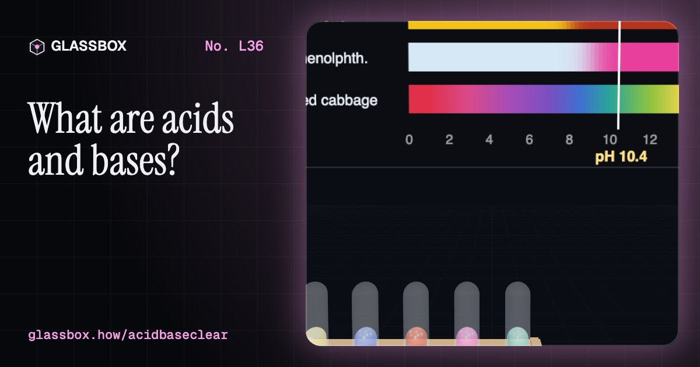
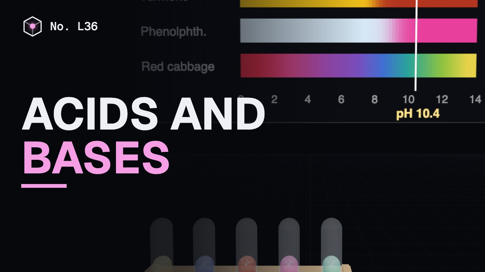
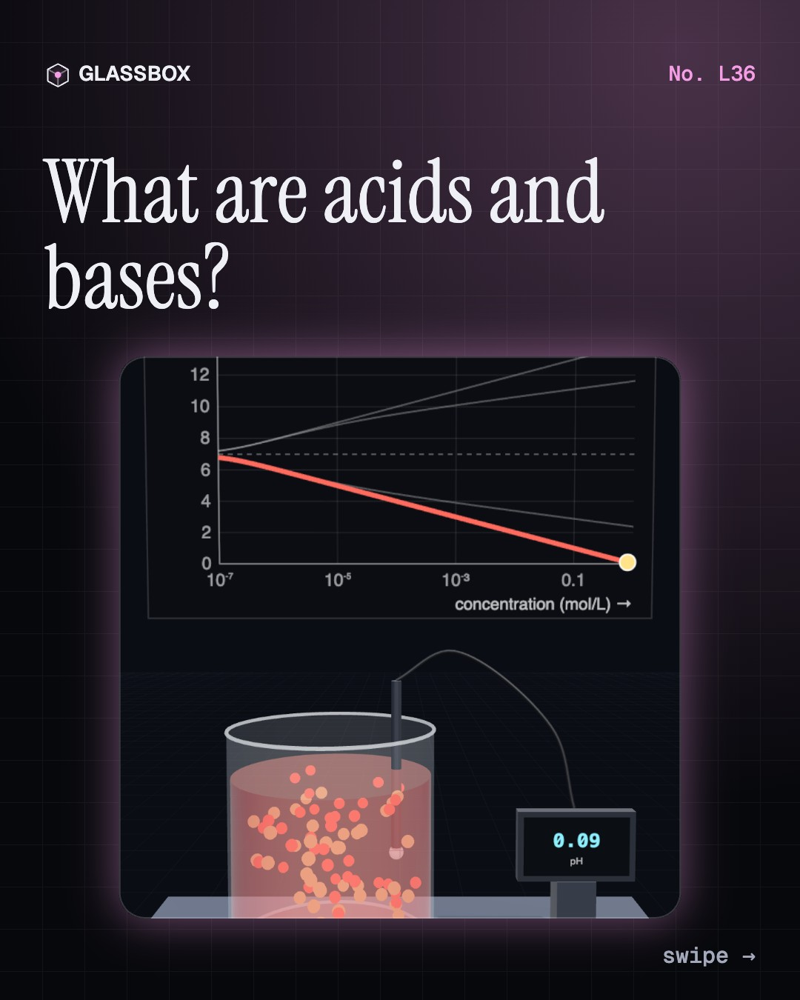
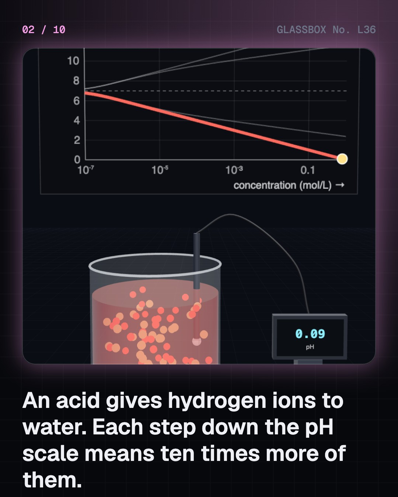
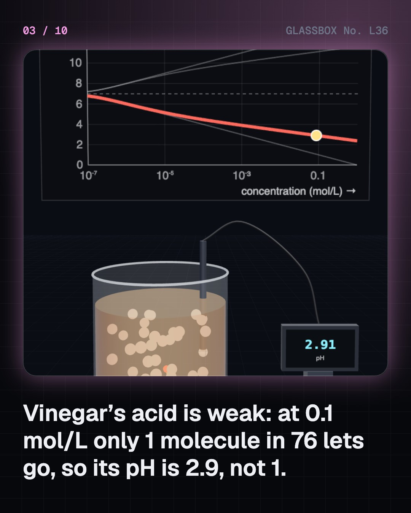
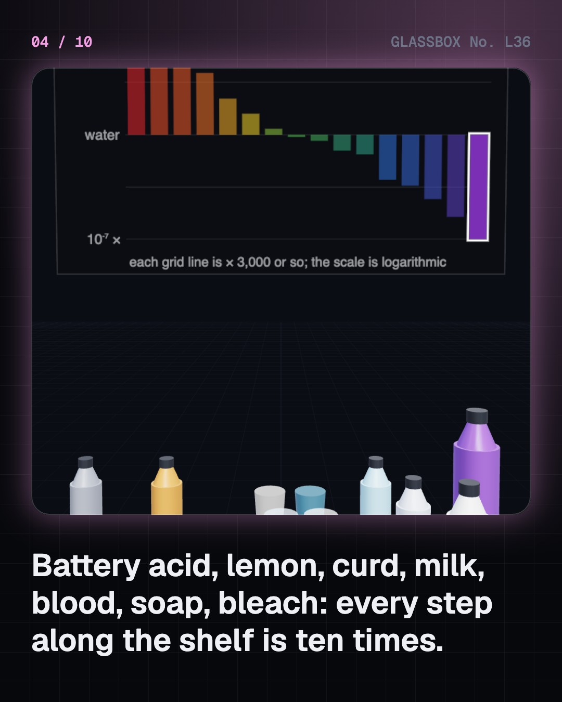

<!-- glassbox:start -->
<!-- Generated from glassbox.json by the Glassbox hub (npm run readme -- acidbaseclear). Edit glassbox.json, not this block. -->
<p align="center"><a href="https://glassbox.how/e/acidbaseclear/"></a></p>

<h1 align="center">Acids and bases</h1>

<p align="center"><b>What are acids and bases?</b><br>Lemon juice has about 20,000 times more hydrogen ions than milk, and one drop can swing a flask from pH 4 to pH 10. Solve real pH from real equilibrium constants, run a titration, watch a haldi stain turn red, see why blood stays at 7.4, and test what alkaline water really does to stomach acid.</p>

<p align="center"><a href="https://glassbox.how/acidbaseclear/"><b>▶ Play with it</b></a> &nbsp;·&nbsp; <a href="https://glassbox.how/e/acidbaseclear/">Read the 60-second explainer</a> &nbsp;·&nbsp; <a href="https://glassbox.how/acidbaseclear/glassbox/reel.mp4">Watch the 40-second video</a></p>

<p align="center">
  <a href="https://glassbox.how/e/acidbaseclear/"></a>
  <a href="https://glassbox.how/e/acidbaseclear/"></a>
  <a href="LICENSE"></a>
  <a href="LICENSE-CONTENT.md"></a>
  <a href="#privacy"></a>
</p>

## In 60 seconds

1. **The pH scale.** An acid gives a proton to water, making H₃O⁺; a base takes one, leaving OH⁻. The two always multiply to 10⁻¹⁴ at 25 °C. pH is minus the log of the hydrogen ion concentration, so each step is a factor of ten. A strong acid ionises completely; a weak one, like vinegar's acetic acid, only about 1 molecule in 76 at 0.1 mol/L. The model solves the pH from the real constants.
2. **Around the house.** Lemon juice is about pH 2.3, curd 4.6, milk 6.6, blood 7.4, baking soda 8.3, soap 9 to 10, bleach about 12.5. Indicators are dyes that change colour as they gain or lose a proton: litmus red to blue, phenolphthalein colourless to pink, and turmeric yellow to red-brown, which is why soap turns a haldi stain red.
3. **Neutralisation.** Acid plus base gives a salt and water. In a titration the pH barely moves until the last drop, then jumps six units, because pH is a logarithm. A weak acid's end point sits above 7. Antacids are mild bases: baking soda, chalk and magnesium hydroxide each neutralise a fixed amount of acid per gram.
4. **Buffers, blood, teeth and rain.** A weak acid mixed with its salt soaks up added acid or base. Blood's bicarbonate buffer, with lungs and kidneys, holds pH 7.35 to 7.45. Sugar drops plaque below pH 5.5, where enamel dissolves, for about a quarter of an hour each time. Clean rain is pH 5.6; pollution makes acid rain that attacks marble.
5. **Limits and a myth.** pH can go below 0 and above 14. Hydrochloric acid at 10⁻⁸ mol/L is pH 6.98, not 8. Pure water at 100 °C is pH 6.1 and still neutral. Lewis widened acids to anything that accepts an electron pair. And a glass of pH 9.5 alkaline water changes stomach-strength acid exactly as plain water does: pH is not neutralising power.

## Words worth knowing

| Term | Meaning |
|---|---|
| **Acid** | A substance that gives a proton (H⁺) to another. In water it raises the amount of H₃O⁺. |
| **Base** | A substance that takes a proton. In water it raises the amount of OH⁻. A base that dissolves in water is an alkali. |
| **pH** | Minus the logarithm of the hydrogen ion concentration in mol/L. One step is a factor of ten; 7 is neutral at 25 °C. |
| **Strong and weak** | A strong acid or base ionises completely in water. A weak one ionises only partly, as its Ka describes. It is not the same as concentrated and dilute. |
| **Indicator** | A dye that is one colour in acid and another in base, such as litmus, phenolphthalein or turmeric. |
| **Neutralisation** | An acid and a base reacting to make a salt and water: H₃O⁺ + OH⁻ → 2 H₂O. |
| **Titration** | Measuring an acid or base by adding its opposite from a burette until an indicator shows they exactly match. |
| **Buffer** | A weak acid mixed with its salt. It resists changes in pH, as the bicarbonate in blood does. |

## A short history

**From a sour taste and a lichen dye to ions, protons and a number called pH.**

- **1664** · Boyle's colours (Robert Boyle, London)
- **1777** · Lavoisier's wrong guess: oxygen makes acids (Antoine Lavoisier, Paris)
- **1810** · Davy: no oxygen in muriatic acid (Humphry Davy, London)
- **1872** · Acid rain gets its name (Robert Angus Smith, Manchester)
- **1884** · Arrhenius: acids are ions in water (Svante Arrhenius, Uppsala)
- **1909** · Sørensen invents pH (Søren Sørensen, Carlsberg Laboratory, Copenhagen)
- **1923** · Brønsted and Lowry: pass the proton (Johannes Brønsted; Thomas Martin Lowry, Copenhagen and Cambridge)
- **1934** · Beckman's pH meter (Arnold Beckman, Pasadena, California)

The full story, with 20 moments, charts, people and 38 sources: [glassbox.how/e/acidbaseclear/history](https://glassbox.how/e/acidbaseclear/history/). The data lives in [`history.json`](history.json).

## Video and slides

Made with the Glassbox studio from this box's storyboard (`window.glassbox.director`). Free to reuse under CC BY 4.0.

<a href="https://glassbox.how/acidbaseclear/glassbox/video.mp4"></a>

<p><a href="glassbox/slide-1.jpg"></a> <a href="glassbox/slide-2.jpg"></a> <a href="glassbox/slide-3.jpg"></a> <a href="glassbox/slide-4.jpg"></a></p>

| File | What | Size |
|---|---|---|
| [`glassbox/reel.mp4`](https://glassbox.how/acidbaseclear/glassbox/reel.mp4) | Reel / Short, with captions and soundtrack | 1080×1920 |
| [`glassbox/video.mp4`](https://glassbox.how/acidbaseclear/glassbox/video.mp4) | YouTube video, with captions and soundtrack | 1920×1080 |
| `glassbox/slide-1…10.jpg` | Instagram carousel | 1080×1350 |
| `glassbox/thumb.jpg` | YouTube thumbnail | 1280×720 |
| `glassbox/cover.jpg` | Share card and repo social preview | 1200×630 |
| [`glassbox/history-reel.mp4`](https://glassbox.how/acidbaseclear/glassbox/history-reel.mp4) | “History in 10 moments” Reel / Short | 1080×1920 |
| `glassbox/history-slide-*.jpg` | History carousel | 1080×1350 |
| `glassbox/post.json` | Post copy and schedule used by the publish kit | |

## Privacy

This box has no accounts and no ads, and it ships its own fonts and libraries. When you run it yourself it sends nothing anywhere. On glassbox.how, the site's `/bar.js` also loads Glassbox's analytics: **Google Analytics** to count visits (it asks first in the EU, UK and Switzerland, and stays off when your browser sends Global Privacy Control or Do Not Track) and **ClickTrust** to detect bots.

It remembers a few things **in your own browser only**, and never sends them anywhere:

| Browser storage key | What it holds |
|---|---|
| `acidbaseclear.v1` | Which chapters you have opened, your best quiz scores, and sound on or off. |

Exactly what each one sees is at [glassbox.how/privacy](https://glassbox.how/privacy/).

## Licences

- **Code:** [MIT](LICENSE). Use it, change it, ship it.
- **Explanations, text, images and videos** (`glassbox.json`, `glassbox/`): [CC BY 4.0](LICENSE-CONTENT.md). Credit “Glassbox, glassbox.how/e/acidbaseclear”.
- **Third-party parts** keep their own licences: [three.js](https://threejs.org) (MIT), [Geist, Instrument Serif](https://openfontlicense.org) (SIL OFL 1.1).
- The Glassbox name and logo aren't covered by either licence. See the [terms](https://glassbox.how/terms/).

Found a mistake? [Open an issue](https://github.com/bdeeps/acidbaseclear/issues). Corrections happen in public.
<!-- glassbox:end -->

## Run it

It's plain HTML, CSS and JavaScript. No build step and no dependencies. Run locally, it contacts no other website.

```bash
python3 -m http.server 8000
```

Three.js and the fonts ship in `vendor/` and `fonts/`, so it also works offline.

Then open http://localhost:8000.

## How it's built

| File | What |
|---|---|
| `index.html`, `css/app.css` | The page and its styles |
| `js/acid.js` | Shared chemistry for this box: the charge-balance pH solver, sourced Ka, Kw and Ksp values, indicator colours, chart boards and glassware |
| `js/app.js`, `js/stage.js`, `js/ui.js`, `js/kit.js` | The shared Glassbox 3D engine: chapters, 3D stage, controls, quiz, video director |
| `js/chapters/*.js` | One file per chapter: the 3D model, controls, text, key terms, quiz and video scenes |
| `glassbox.json` | Title, question, explainer beats, key terms, browser storage and credits shown on glassbox.how |
| `reel` in each chapter | The storyboard the Glassbox studio records into short videos |
| `glassbox/` | The published video, slides, thumbnail and post copy |
| `fonts/`, `vendor/three/` | Self-hosted Geist and Instrument Serif (SIL OFL 1.1) and three.js (MIT) |
